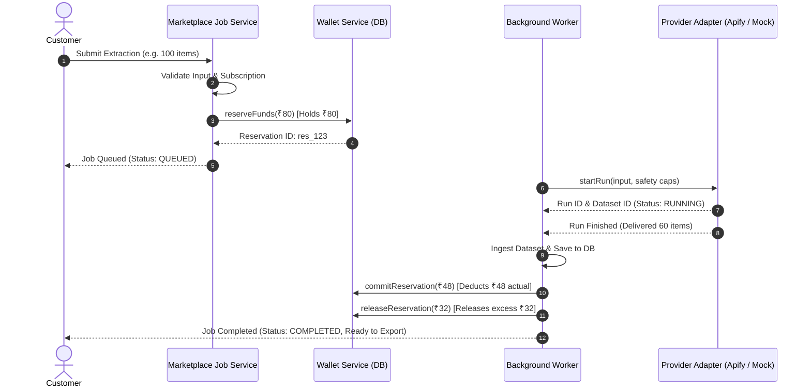

# White-Label Data Extraction Marketplace — Base Platform Guide

Welcome to the foundation of the **White-Label Data Extraction Marketplace**. This base platform turns external web scrapers and actors into customer-facing, high-margin data extraction products without ever exposing the underlying provider (Apify) or raw upstream URLs.

Adding any new extraction product is purely **configuration-driven** via JSON (`ProductDefinition` schema v1) — zero code rewrites or custom endpoints required.

---

## 🏗️ 1. Core Principles & Architecture

1. **Config-Driven Products**: Every product is a record in the `extraction_marketplace_products` database table. Adding a product requires only adding/updating a `ProductDefinition` JSON record.
2. **Provider Abstraction**: A standardized `ProviderAdapter` interface sits between the platform and upstream engines. Out-of-the-box support includes:
   - `ApifyAdapter`: Production engine with retries, timeout management, rate-limit protection, and safety cost limits (`maxTotalChargeUsd`).
   - `MockProviderAdapter`: High-fidelity sandbox adapter for offline development and CI/CD testing without real credentials.
3. **Strict White-Labeling**:
   - Customer UI, API JSON responses, dataset exports (CSV/Excel/JSON), socket events, and errors are intercepted by `WhiteLabelSanitizer`.
   - Never exposes "Apify", "actor", or `api.apify.com`. Customer terminology is strictly **Product / Extraction / Job / Credits**.
4. **Server-Side Pricing & Currency**:
   - Upstream costs in USD are converted to the platform base currency (`INR`) at runtime via the existing `CurrencyService`.
   - Client requests never determine charges.
5. **Data Ownership**:
   - Results are automatically ingested from temporary provider datasets into the local SQLite database (`marketplace_job_results`). We never depend on external dataset persistence.
6. **Atomic Ledger Settlement**:
   - Built on top of the platform's `WalletService`.
   - **Reserve on Queue**: Estimated max cost is placed on hold (`usage_reservation`).
   - **Commit on Delivery**: Only actual items delivered are charged (`usage_deduction`).
   - **Release Excess**: Any difference between reserved and actual is returned immediately to available balance.
   - **100% Refund on Abort/Failure**: If a job aborts or fails with 0 results, 100% of the held funds are released.

---

## 🛠️ 2. Environment Configuration

Add the following environment variables to your `.env` file:

```bash
# Apify Integration
APIFY_API_TOKEN=apify_api_your_token_here
APIFY_WEBHOOK_SECRET=your_webhook_signing_secret_here

# Marketplace Retention (Auto-cleanup period for raw result records)
MARKETPLACE_RETENTION_DAYS=30
MARKETPLACE_DEFAULT_CURRENCY=INR
```

> **Note**: Even if `APIFY_API_TOKEN` is not yet configured, the system works immediately out of the box using the bundled `mock` adapter!

---

## 📦 3. How to Add a New Product

To add a new product (e.g. Google Maps Extractor, LinkedIn Lead Finder, YC Scraper), use either:
1. **Admin Hub UI**: Go to **Admin Control Center** -> **Data Extraction Hub** -> Click **+ New Product** or **Import from Provider ID**.
2. **Database Seed / API**: Insert directly into `extraction_marketplace_products`.

### ProductDefinition JSON Schema (v1)

```json
{
  "slug": "unique-product-slug",
  "display_name": "Verified Business Lead Extractor",
  "tagline": "Extract verified business emails, social links & domains with zero setup",
  "description_md": "Full markdown description explaining what data is returned...",
  "category": "B2B & Sales",
  "icon": "Building2",
  "status": "active",

  "provider": {
    "type": "apify",
    "actor_id": "username~actor-name-or-id",
    "build": "latest"
  },

  "input": {
    "fields": [
      {
        "key": "query",
        "provider_key": "searchQueries",
        "label": "Search Keywords or Industry",
        "help": "e.g. Software SaaS, Real Estate, Cafes",
        "type": "text",
        "required": true,
        "default": "Tech Startups",
        "visible_to_user": true
      },
      {
        "key": "max_results",
        "provider_key": "maxItems",
        "label": "Max Leads to Extract",
        "type": "number",
        "required": false,
        "default": 50,
        "min": 5,
        "max": 500,
        "visible_to_user": true
      }
    ],
    "static_overrides": {
      "proxyConfiguration": { "useApifyProxy": true }
    },
    "hidden_defaults": {
      "includeUnverified": false
    }
  },

  "limits": {
    "min_items": 1,
    "max_items_per_run": 1000,
    "max_concurrent_runs_per_user": 2,
    "timeout_secs": 3600,
    "memory_mb": 1024
  },

  "pricing": {
    "mode": "per_item",
    "provider_cost_reference": {
      "model": "pay_per_result",
      "usd_per_1000_items": 2.50,
      "usd_per_run_start": 0.05,
      "notes": "Apify standard pay-per-result rate"
    },
    "sell": {
      "per_1000_items": 800,
      "per_run_flat": 0
    },
    "margin": {
      "type": "percent",
      "value": 50
    },
    "min_charge": 10
  },

  "access": {
    "requires_subscription": false,
    "allowed_plan_slugs": []
  },

  "output": {
    "item_mapping": [
      { "from": "title", "to": "company_name", "label": "Company Name", "type": "string", "hidden": false },
      { "from": "email", "to": "primary_email", "label": "Email Address", "type": "string", "hidden": false },
      { "from": "phone", "to": "contact_phone", "label": "Phone Number", "type": "string", "hidden": false },
      { "from": "website", "to": "domain_url", "label": "Website", "type": "url", "hidden": false }
    ],
    "drop_fields": ["debug", "errorLog", "_rawHtml"],
    "preview_columns": ["company_name", "primary_email", "contact_phone"],
    "export_formats": ["csv", "xlsx", "json"],
    "sanitize": {
      "strip_provider_urls": true,
      "strip_emails": false,
      "strip_phones": false,
      "custom_regex_remove": []
    }
  }
}
```

---

## 💰 4. Pricing Modes & Margin Helper

The engine supports 3 flexible pricing modes:

| Mode | Formula | Use Case |
|---|---|---|
| `per_item` | `(items / 1000) * sell.per_1000_items` | Pay-per-result extractors (leads, reviews, tweets) |
| `per_run` | `sell.per_run_flat` | Fixed-price tasks (full profile audit, SEO check) |
| `per_item_plus_run` | `sell.per_run_flat + (items / 1000) * sell.per_1000_items` | High-overhead scrapers with startup runtime costs |

- **Minimum Charge (`min_charge`)**: Protects against tiny runs that cost compute but generate low revenue.
- **Margin Helper**:
  - In Admin Hub -> Margin Tool, enter upstream USD costs (e.g., \$5/1000 items) and target profit margin (e.g., 50%).
  - Auto-converts to INR using current platform exchange rates and calculates the optimal selling price.

---

## 🛡️ 5. Safe Settlement & Atomic Reservation Flow



---

## 🧪 6. Automated Verification Test Suite

Run the full automated test suite anytime:

```bash
npm --prefix backend run test:marketplace
```

### Verified Test Cases:
1. **Schema Integrity**: Verifies all 6 marketplace tables (`extraction_marketplace_products`, `product_pricing_history`, `marketplace_jobs`, `marketplace_job_results`, `marketplace_provider_events`, `marketplace_settings`).
2. **White-Label Leak Audit**: Asserts that customer responses, JSON objects, URLs, and exports never contain "Apify", "actor", or `api.apify.com`.
3. **Pricing Calculations**: Validates `per_item`, `per_run`, `per_item_plus_run`, minimum charges, and margin previews with currency conversions.
4. **Mock Provider Adapter**: Validates sandbox execution, run status polling, and dataset retrieval.
5. **Atomic Ledger Settlement**: Tests hold -> execution -> partial commit -> excess release flow against `WalletService`.
6. **Full Refund on Abort**: Tests user-initiated or failure-initiated aborts and guarantees 100% reservation release.

---

## 🚀 7. Customer & Admin Navigation

- **Customer View**: Click **Data Hub** in the left sidebar to access the Extraction Marketplace catalog, dynamic configuration modal, live price slider, running jobs, and dataset downloads.
- **Admin Hub**: Navigate to **Admin Control Center** -> **Data Extraction Hub** tab to manage products, import from provider IDs, test runs, view jobs & financial margins, and configure provider credentials.
